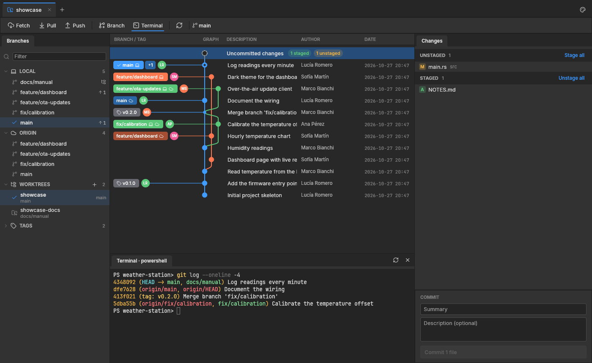

# gitcraft

A small, personal visual git client: a simplified take on the usual graph-based git GUIs.
Rust + [egui/eframe](https://github.com/emilk/egui), the same stack and look as WordCraft and
PhotoCraft, so it builds on Windows, Linux and macOS. It drives the installed `git` command line,
so your config, credentials and hooks apply as usual.



## Features

**Repositories and tabs**
- Start page: checks that `git` is installed; open, create (`git init`) or clone a repository;
  recent repositories.
- Browser-like tabs, one per repository (Ctrl+T, Ctrl+W, middle-click). Open tabs, recents,
  theme and settings are remembered.
- Changes made elsewhere (editor, terminal) show up by themselves: the folder is watched.

**Graph**
- Every branch, coloured lanes, ↑/↓ to move. History loads 1500 commits at a time as you scroll.
- Branch and tag pills in their own column left of the graph, on each branch's tip only, joined
  to their commit: white text, a laptop icon when the branch is local, a cloud when a remote has
  it at that commit (`x` and `origin/x` make one pill), a pull-request icon when one is open,
  `+N` when more refs share the commit, the author's avatar and how long ago it was ("2 hours
  ago"). Author, date and hash columns are optional (Settings).
- An *Uncommitted changes* row on top while the working tree is dirty.
- Search (Ctrl+F) through messages, authors and hashes of all history; Enter / Shift+Enter jump
  between results, loading older history when needed.
- Right-click a commit: create a branch or a tag, check it out, cherry-pick, revert, reset the
  current branch to it (soft / mixed / hard, confirmed), the menu of each branch on it.

**Branches, remotes, worktrees, stashes, tags** (left)
- Local branches with ahead/behind; right-click: check out (or in a new worktree), merge into /
  rebase onto the current branch, push, create a pull request, rename, delete…
- Remotes: add, edit (name and URL), fetch one, remove; their branches below each.
- Worktrees: add (existing or new branch), open in a tab, open a terminal there, lock, remove,
  prune.
- Stashes: stash (with a message, untracked files included), see what a stash holds, apply, pop,
  drop.
- Pull / merge requests of GitHub (through `gh`) or GitLab (through `glab`): list, open in the
  browser, check out, create from a branch.
- Tags: create (light or annotated, optionally pushed), push, delete locally or on the remote.

**Changes and commits** (right)
- Conflicted / unstaged / staged lists with stage, unstage, discard and mark-resolved buttons,
  *Stage all* / *Unstage all*; right-click a file to open it, open it in your editor or show it in
  its folder.
- Commit box (Ctrl+Enter; with nothing staged it stages everything), *Amend last commit*
  (warns when the commit is already pushed), the identity you commit as, and saved identities to
  switch a repository to.
- Undo / redo (Ctrl+Z / Ctrl+Y) of commits, amends, merges, rebases, pulls, resets,
  cherry-picks, reverts, checkouts, branch create / rename / delete, tags and stashes.

**Diffs and conflicts** (centre)
- Unified or side by side, syntax colours, the changed part of each line marked, whitespace
  changes optional, images shown before / after. Esc closes.
- Conflicts open in a three-pane editor: each conflict's two sides with *Ours*, *Theirs* and
  *Both* buttons, and the result below (editable). *Use mine* / *Use theirs* for a whole file.
- A merge, rebase, cherry-pick or revert stopped on conflicts shows a banner with *Abort*; the
  commit box finishes it (*Continue rebase* during a rebase).

**Toolbar, terminal, app**
- Undo, redo, Fetch, Pull and Push (with incoming / outgoing counts), new branch, stash, terminal,
  search, open the folder (Explorer / Finder, your editor), refresh (F5).
- Background fetch every few minutes (Settings; 0 turns it off).
- Terminal panel with tabs: PowerShell, cmd, Git Bash, WSL… on Windows, your shells elsewhere, in a
  real pseudo-terminal (ConPTY on Windows) with colours, scrollback, mouse selection and copy
  (Ctrl+C with a selection, Ctrl+Shift+C or right-click).
- Command palette (Ctrl+P): every action and branch, fuzzy matched.
- Settings: zoom, branch column width, graph columns, avatars from Gravatar / GitHub (sends a hash
  of each author's email; can be turned off), notifications, background fetch, editor command,
  default shell and terminal font size, saved identities.
- Toasts, and a desktop notification when a long operation ends while the window is in the
  background.
- Themes: Dark, Medium Gray and Light, from PhotoCraft's Pro palettes.

## Download

Ready-made builds for Windows and Linux (x86-64) are on the
[releases page](https://github.com/Vancete/gitcraft/releases): unzip and run `gitcraft.exe`
(Windows) or `gitcraft` (Linux). Git must be installed. A release is built by
`.github/workflows/release.yml` whenever a `v*` tag is pushed.

## Build and run

```bash
cargo run --release                   # start
cargo run --release -- path/to/repo   # open a repository directly
cargo test
```

Linux needs the usual eframe system packages (e.g. `libxkbcommon-dev`, `libgtk-3-dev` for the
file dialogs, `libdbus-1-dev` for notifications). Pull requests need the GitHub CLI (`gh`) or
GitLab CLI (`glab`), logged in.

### Looking at the UI headlessly

`examples/ui_shot.rs` drives the app without a window (egui_kittest) and saves PNGs:

```bash
cargo run --example ui_shot -- path/to/repo /tmp/shot click:500,266 shot key:Escape shot
```

Steps: `click:x,y`, `dclick:x,y`, `rclick:x,y`, `drag:x1,y1,x2,y2`, `hover:x,y`, `leave`,
`key:Name`, `ckey:Name` (with Ctrl / Cmd), `type:text`, `wait:ms`, `shot`. The README screenshot
was made this way, on a demo repository.

## Layout

| File | Job |
|---|---|
| `src/git.rs` | `git` CLI wrapper and output parsing (refs, log, status, stashes, remotes, search) |
| `src/graph.rs` | lane layout for the commit graph |
| `src/forge.rs` | pull / merge requests through `gh` and `glab` |
| `src/avatars.rs` | avatars from Gravatar / GitHub, cached on disk |
| `src/settings.rs` | user settings and their form |
| `src/theme.rs` | colour tokens, fonts, egui style (PhotoCraft's Pro themes) |
| `src/icons.rs` | embedded Lucide SVG icons, tinted |
| `src/terminal.rs` | integrated terminal: pty, VT parsing (`vt100`), painting, keys, selection |
| `src/repo/mod.rs` | one repository tab: state, background git work, undo / redo, toolbar |
| `src/repo/sidebar.rs` | branches, remotes, worktrees, stashes, pull requests, tags |
| `src/repo/graph_view.rs` | commit graph, pills, search bar, commit menu |
| `src/repo/detail.rs` | commit / stash detail, changes and commit box |
| `src/repo/diff.rs` | diff loading, pairing and the diff view (unified, split, images) |
| `src/repo/highlight.rs` | syntax colours (syntect) |
| `src/repo/conflict.rs` | three-pane conflict editor |
| `src/repo/dialogs.rs` | branch, tag, stash, remote, worktree, pull request and confirm dialogs |
| `src/repo/widgets.rs` | shared painted widgets (panel headers, file rows, avatars, tabs) |
| `src/app.rs` | window shell: tabs, start page, cloning, palette, settings, toasts |

Assets and their licences: [ATTRIBUTION.md](ATTRIBUTION.md).

## License

MIT OR Apache-2.0, at your option ([LICENSE-MIT](LICENSE-MIT), [LICENSE-APACHE](LICENSE-APACHE)).
